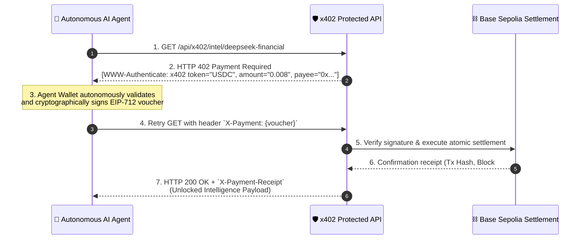

# ⚡ Synapse402 — Autonomous Agent Micropayment Mesh
> **An Internet-Native M2M Micropayment Infrastructure powered by the x402 (HTTP 402 "Payment Required") Open Standard on Base Sepolia.**

---

## 🎯 Executive Summary & The Problem

In the emerging agentic internet, **autonomous AI agents** need to procure real-time data, execute security audits, run specialized LLM compute, and fetch satellite feeds on a millisecond basis. 

However, **the traditional web is broken for AI agents**:
- ❌ **Human Friction:** Legacy Web2 SaaS demands human signup, email verification, passwords, and 2FA.
- ❌ **Subscription Lock-in:** Forcing agents into $50–$250/month credit card subscriptions for a service they may only query once.
- ❌ **Payment Incompatibilities:** Autonomous agents cannot hold credit cards or solve CAPTCHA checkouts.

### 💡 The Solution: Synapse402 & The x402 Protocol
**Synapse402** revitalizes the dormant **HTTP 402 ("Payment Required")** status code, implementing the open **x402 standard** (championed by Coinbase and the Linux Foundation) to provide a friction-free, accountless financial layer for autonomous machine-to-machine (M2M) commerce.



---

## 🚀 Key Features

### 1. 🤖 Autonomous Swarm Mission Controller
Experience AI agents executing multi-hop intelligence missions in real time:
- **Quant Due Diligence:** Procures live financial order-flow sentiment, scrapes SEC filings, and embeds semantic vectors.
- **DeFi Exploit Scanner:** Audits smart contract bytecode, computes vulnerability vectors, and generates formal mitigation reports.
- **Orbital Supply Chain Forensics:** Obtains Synthetic Aperture Radar (SAR) satellite passes and cross-references global port congestion.
- The agent plans, negotiates HTTP 402 challenges, signs micro-transactions autonomously within its spending budget, and synthesizes an executive dossier.

### 2. 🔬 Interactive x402 Protocol Inspector ("The Lab")
A side-by-side terminal allowing judges and developers to step through the exact cryptographic handshake:
- **Step 1:** Issue raw request -> Inspect HTTP 402 response, `WWW-Authenticate` header, and challenge JSON.
- **Step 2:** Generate and sign the EIP-712 typed payment voucher with the agent's private key.
- **Step 3:** Resend with `X-Payment` -> Inspect HTTP 200 OK, `X-Payment-Receipt`, transaction hash, and payload.

### 3. 🌐 API Mesh Marketplace & Publisher
- Pre-built monetized endpoints ranging from **0.003 USDC to 0.025 USDC** per call.
- **1-Click Publisher:** Any developer can monetize their own API endpoint in seconds with a custom path, price in USDC, and destination wallet address.

### 4. ⛓️ On-Chain Settlement Ledger & Testnet Faucet
- Real-time audit log of all settled agentic micro-transactions on Base Sepolia.
- Live metrics: Transaction latency (avg 38ms), Base L2 gas overhead (~0.0001 USDC), block height, and mesh volume.
- Integrated **Agent Smart Account Testnet Faucet** for instant USDC balance top-ups.

### 5. 🛠️ Developer SDK & Middleware
- Seamless client-side agent wrapper in **TypeScript** and **Python**.
- **1-line Express middleware** (`x402Guard`) that turns any web API into a monetized x402 resource.

---

## 📦 Project Structure

```
g:/x402/
├── middleware/
│   └── x402.js             # RFC-compliant x402 HTTP Guard & Settlement Middleware
├── services/
│   ├── ledger.js           # Base Sepolia Ledger & Agent Wallet State Manager
│   ├── apiRegistry.js      # Catalog of Monetized x402 Services & Dynamic Router
│   └── agentEngine.js      # Autonomous Swarm Mission Engine (Multi-Hop Handshakes)
├── public/
│   ├── index.html          # Neo-Fintech Cyberpunk UI with Glassmorphism
│   ├── css/
│   │   └── style.css       # Custom Design System, Animations & Responsive Styles
│   └── js/
│       └── app.js          # Interactive UI Controller, Terminal & State Machine
├── tests/
│   └── test-x402.js        # Automated Spec Compliance Integration Test Suite
├── server.js               # Node.js / Express Full-Stack Server
├── package.json            # Scripts and Dependencies
└── README.md               # Documentation & Hackathon Judging Guide
```

---

## ⚡ Quickstart & Local Installation

### Prerequisites
- Node.js **v18+** (v24 tested)
- npm **v9+**

### 1. Install Dependencies
```bash
npm install
```

### 2. Run Spec Compliance Integration Test
Verify the two-step HTTP 402 challenge and settlement handshake:
```bash
npm test
```
*Expected output: All 3 handshake steps pass with 100% specification compliance.*

### 3. Start the Application
```bash
npm start
```
Open **[http://localhost:4020](http://localhost:4020)** in your browser to experience the full interactive platform.

---

## 🧪 Evaluation & Judging Verification Guide

Judges can verify all aspects of the application directly:

1. **Protocol Compliance:**
   - Run `npm test` to verify standard HTTP status codes (`402 Payment Required` -> `200 OK`), headers (`WWW-Authenticate: x402 ...`, `X-Payment`, `X-Payment-Receipt`), and cryptographic nonce expiration.
2. **Autonomous Swarm Demonstration:**
   - In the web UI, select **"Autonomous Swarm Mission"** and click **"Launch Autonomous Agent Mission"**.
   - Watch the agent identify paywalls, execute 402 challenge negotiation, sign micropayments, and decrypt the intelligence dossier.
3. **Interactive Step-by-Step Handshake:**
   - Navigate to the **"x402 Protocol Inspector"** tab.
   - Click through **Step 1**, **Step 2**, and **Step 3** to visually inspect the exact headers, typed data, and Base Sepolia settlement receipts.
4. **Endpoint Monetization:**
   - Go to **"API Mesh Marketplace"**, click **"Publish x402 Endpoint"**, register a new endpoint, and inspect it immediately in the lab.

---

## 📜 Technology Stack

- **Backend:** Node.js, Express 5, Crypto (EIP-712 payload signing & nonce generation), CORS
- **Network Rail:** Base Sepolia (EVM 84532) / USDC Micropayment Architecture
- **Protocol:** x402 Standard (HTTP 402 specification for AI Agents)
- **Frontend:** Modern Vanilla JavaScript, Neo-Fintech Glassmorphic CSS Design System, Lucide Icons

---

## 📄 License
MIT License. Built for the x402 Hackathon Challenge.
